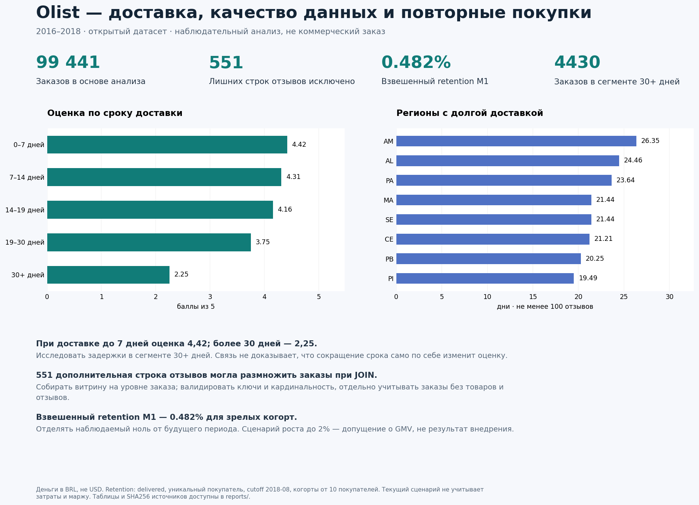

# Olist — качество данных, доставка и повторные покупки

Личный аналитический проект на открытом датасете Olist за 2016–2018 годы.
Задача: собрать корректную витрину заказов, исследовать связь доставки с оценкой
и оценить повторные покупки с учётом наблюдаемого горизонта.

**Без чтения кода:** [выводы и рекомендации](reports/EXECUTIVE_SUMMARY.md) ·
[интерактивный HTML — скачать и открыть](https://github.com/salaticc/olist-ecommerce-analysis/raw/refs/heads/main/docs/index.html) ·
[исправления](CHANGELOG.md).



## Что показал пересчёт

| Наблюдение | Результат | Что следует проверить |
|---|---|---|
| Сборка витрины | 99 441 заказ; 551 дополнительная строка отзывов исключена | Ключи и кардинальность каждого JOIN |
| Доставка до 7 дней | Средняя оценка 4,42 из 5 | Факторы сервиса и состав заказов |
| Доставка более 30 дней | 4 430 заказов; оценка 2,25 | Причины задержек в этом сегменте |
| Взвешенный retention M1 | 0,4816% | Зрелость когорт и полнота источника |

Связь доставки и оценки наблюдательная. «Порог 19 дней» из исходного
анализа считается исследовательским разрезом, а не доказанной причинной границей.

## Контракт расчётов

- Одна строка витрины = заказ; items агрегируются до объединения, отзыв выбирается по явному правилу последней записи.
- Проверяются уникальность ключей, orphan-записи и merge validate; число заказов сохраняется.
- Доставка: delivered, неотрицательный интервал, непротиворечивые даты и известная оценка. Для seller-анализа даты валидируются отдельно.
- Retention: delivered, customer_unique_id, cutoff **2018-08 до формирования когорт**, минимум 10 покупателей. Будущие периоды — NaN, наблюдаемые пустые — 0.
- M1 взвешен числом покупателей зрелых когорт, не средним заказов или равновесным средним когорт.
- Товарный GMV не включает freight. Валюта **BRL**, не USD.

## Денежный сценарий

Рост M1 до 2% — гипотетический сценарий, не внедрение. Основа: число новых
покупателей средней зрелой когорты, одна повторная покупка и средний товарный чек.
Получено около **9 073,80 BRL дополнительного GMV на среднюю когорту** при этих
допущениях. Маржа и расходы неизвестны, поэтому прибыль не рассчитывается.

## Воспроизвести

```bash
git clone https://github.com/salaticc/olist-ecommerce-analysis.git
cd olist-ecommerce-analysis
python -m venv .venv
# Активируйте окружение вашей ОС
python -m pip install -r requirements.txt
python -m unittest discover -s tests -v
# Скачайте четыре исходных CSV в data/, см. data/README.md
python -m scripts.build_report
```

Проверено на Python 3.12. Ноутбук необязателен; для него установите
`requirements-notebook.txt`. Сырые данные не хранятся в Git; контрольные суммы
пересчитанного источника — [reports/summary.json](reports/summary.json).

## Материалы

[Выполненный ноутбук](notebooks/olist_analysis.ipynb) · [Расчёты](src/analysis.py) ·
[Контрольные таблицы](reports/) · [Тесты](tests/test_analysis.py).

Источник: [Olist на Kaggle](https://www.kaggle.com/datasets/olistbr/brazilian-ecommerce).
Август 2018 — принятый аналитический cutoff; полная выгрузка и история до её начала
не доказаны одним CSV. EDA_report.pdf и reports/images сохранены как исторические материалы;
текущие выводы находятся в EXECUTIVE_SUMMARY.md. Коммерческая работа и прибыль не заявляются.
